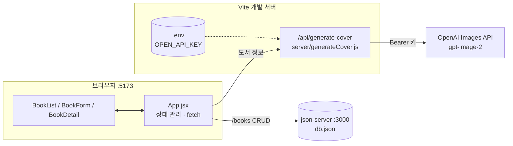
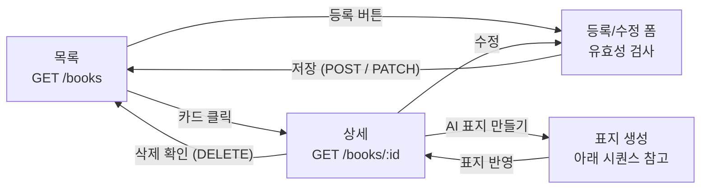
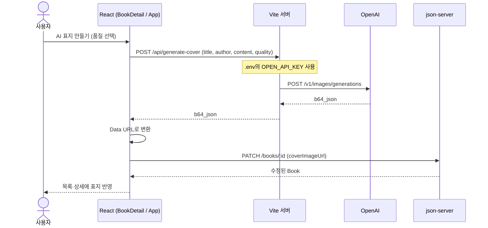

# 도서 관리 서재 (AIVLE 미니프로젝트 4)

도서를 등록·조회·수정·삭제하고, 책 내용을 바탕으로 OpenAI 이미지 모델로 표지를 만들어 주는 미니프로젝트 입니다.

## 주요 기능

- **목록**: 표지·제목·등록일 표시, 검색(제목/저자/내용), 카테고리 탭, 정렬(최신·오래된·별점·제목순)
- **등록/수정**: 제목·저자·카테고리·별점·내용 입력과 유효성 검사, 수정 시 기존 값 자동 로드
- **상세/삭제**: 표지·작성일·수정일·본문 표시, 확인 다이얼로그 후 삭제
- **AI 표지**: 제목·저자·내용으로 표지 생성(품질 low/medium/high), 재생성 가능, 목록·상세 자동 반영

## 기술 스택

| 구분 | 사용 |
| --- | --- |
| 프론트엔드 | React 19, Vite, MUI |
| 데이터 서버 | json-server 0.17.4 (`db.json`) |
| AI 표지 | OpenAI Images API (`gpt-image-2`), Vite 개발 서버 미들웨어로 프록시 |
| 린트 | oxlint |

## 아키텍처



- 도서 데이터는 React가 json-server에 직접 CRUD 요청합니다.
- 표지 생성은 Vite 개발 서버가 `.env`의 키로 OpenAI를 대신 호출합니다. 키는 브라우저로 가지 않습니다.

## 화면 흐름



## 폴더 구조

```
miniproject4/
├── db.json                       # json-server 데이터 (books)
└── my-app/                       # React 앱
    ├── server/generateCover.js   # /api/generate-cover 핸들러 (OpenAI 호출)
    ├── vite.config.js            # 위 핸들러를 개발 서버에 연결
    └── src/
        ├── App.jsx               # 상태 관리, json-server 요청
        ├── components/           # BookList, BookForm, BookDetail 등
        └── utils/                # categories, formatDate
```

## 실행 방법

Node.js 20.19 이상(또는 22.12 이상)이 필요합니다.

```bash
# 터미널 1 (루트): 데이터 서버
npx json-server@0.17.4 db.json --port 3000

# 터미널 2: React 앱 → http://localhost:5173
cd my-app && npm install && npm run dev
```

### API 키 (.env)

> 수업 예제는 홈페이지 화면에서 OpenAI API 키를 직접 입력해 표지를 생성하는 방식이지만, 이 프로젝트는 **`.env` 파일**로 처리했습니다. 키는 Vite 개발 서버만 읽으므로 브라우저에 노출되지 않습니다.

`my-app/.env`에 아래처럼 넣고 `npm run dev`를 다시 시작합니다. (`.env`는 git에서 제외됨)

```
OPEN_API_KEY=sk-...
```

- 변수 이름은 `OPENAI_API_KEY`가 아니라 `OPEN_API_KEY`입니다.
- 표지 생성은 `npm run dev`에서만 동작합니다. (`build`/`preview` 결과물은 미지원)

## API 명세

| 서버 | Base URL | 용도 |
| --- | --- | --- |
| json-server | `http://localhost:3000` | 도서 CRUD |
| Vite 개발 서버 | `http://localhost:5173` | AI 표지 생성 |

요청·응답은 모두 JSON이며 `Content-Type: application/json`을 사용합니다.

### Book

| 필드 | 타입 | 설명 |
| --- | --- | --- |
| `id` | number | POST 시 json-server가 자동 증가로 부여 |
| `title` | string | 필수, 공백 불가, 50자 이하 |
| `author` | string | 필수, 공백 불가 |
| `content` | string | 필수, 10자 이상 1000자 이하 |
| `category` | string | 필수, 소설 / 에세이 / IT / 과학 / 기타 |
| `rating` | number | 필수, 1\~5 |
| `coverImageUrl` | string | 등록 시 `""`, 표지 생성 후 `data:image/png;base64,...` |
| `createdAt`, `updatedAt` | string | ISO 8601, 클라이언트가 설정 |

필수·길이 검사는 화면(BookForm)에서만 하며, json-server는 받은 값을 그대로 저장합니다.

### 도서 API (json-server)

| 메서드 | 경로 | 요청 본문 | 응답 |
| --- | --- | --- | --- |
| GET | `/books` | - | `200` `Book[]` |
| GET | `/books/:id` | - | `200` `Book` |
| POST | `/books` | `id`를 뺀 전체 필드 | `201` `Book` |
| PATCH | `/books/:id` | 바뀐 필드 + `updatedAt` (표지 저장 시 `coverImageUrl`만) | `200` `Book` |
| DELETE | `/books/:id` | - | `200` `{}` |

없는 `id`는 `404` `{}`를 돌려줍니다. 검색·필터·정렬은 목록을 받은 뒤 화면에서 처리합니다.

### 표지 생성 API: `POST /api/generate-cover`

OpenAI `gpt-image-2`로 1024×1536 PNG를 만들어 base64로 돌려줍니다. 저장은 하지 않으며, 클라이언트가 Data URL로 바꿔 `PATCH /books/:id`로 저장합니다.

- **헤더**: `Content-Type: application/json` (정확히 이 값만 허용)
- **본문** (20,000자 이하)
  - `title`, `content`: 필수, 공백 불가
  - `author`: 선택, 서버에서 200자로 자름 (비어 있으면 표지에 제목만 넣음)
  - `quality`: `low` / `medium` / `high`, 기본값 `medium`
- **성공**: `200` `{ "b64_json": "iVBORw0KGgo..." }`
- **실패**: `{ "error": "화면에 보여 줄 메시지" }`

| 상태 | 원인 |
| --- | --- |
| `400` | 잘못된 JSON, `title`/`content` 누락, 잘못된 `quality`, OpenAI 안전 필터 |
| `401`, `403` | OpenAI 키 또는 모델 권한 오류 |
| `405`, `413`, `415` | POST가 아님, 본문 20,000자 초과, JSON이 아님 |
| `429` | OpenAI 사용 한도 초과 |
| `502` | OpenAI 실패, 응답에 이미지 없음, 연결 오류·시간 초과(180초) |
| `503` | `OPEN_API_KEY` 미설정 |



## 참고

- 표지는 base64 Data URL로 `db.json`에 저장되므로 파일 크기가 크게 늘어납니다.
